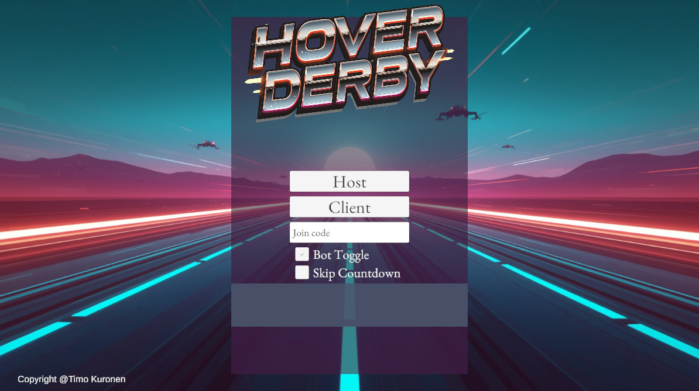
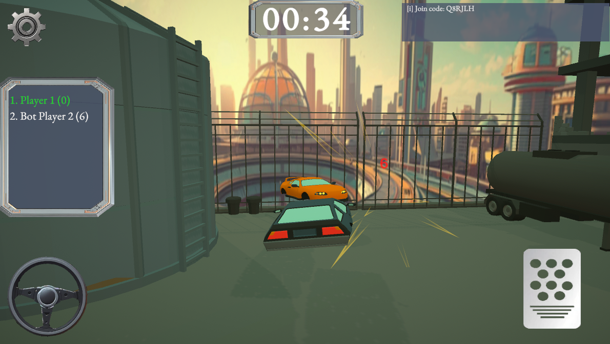

# HoverCar Derby

[](ProjectSettings/ProjectVersion.txt)
[](LICENSE)

Unity multiplayer arena prototype exploring Netcode for GameObjects (NGO), Unity Gaming Services (Auth, Multiplayer Services Sessions), and client/server authority tradeoffs in a demolition-derby style hover car game.





## Highlights

- Host and client session setup via Multiplayer Services sessions (Relay transport, join codes, session browser)
- Player spawning and ownership patterns with Netcode for GameObjects
- Match state machine: cinematic intro, countdown, play, pause, race end
- Hybrid authority: client-owned movement checked by the server for speed and position, server-owned combat and scoring
- Edit-mode tests for collision damage, scoring and movement rules
- UGS Auth and Sessions behind a `NetworkSession` facade
- VContainer DI scopes, EventBus hooks, presenter/view UI on main menu and play HUD

## Architecture

```text
Boot (NetBootstrap)
  -> Network bootstrap (host and client singletons, auth)
  -> Session facade (StartHost, JoinByCode, JoinById, Leave)
  -> Match state machine
  -> Gameplay (hover forces, collision scoring, event bus)
```

| Concern | Authority |
|---------|-----------|
| Movement | Owning client, checked by the server |
| Damage / scoring / collectibles | Server |
| Match phases / timer | Server |

Details: [architecture](docs/architecture.md) · [authority model](docs/authority.md) · [testing](docs/testing.md)

## Stack

| Area | Choice |
|------|--------|
| Engine | Unity `6000.3.29f1` LTS |
| Networking | Netcode for GameObjects |
| Services | UGS Auth, Multiplayer Services (Sessions over Relay) |
| DI | VContainer |
| Other | Cinemachine, Input System |

## Asset credits

- Environment pack: **JC_LP_MegaCity** (not included in the repository)
- Impact VFX: **Cartoon FX Remaster** by Jean Moreno
- Custom / AI-generated UI and title art under `Assets/Limekicker/Art`

Third-party assets remain under their own licenses. They are not covered by the MIT grant below.

## License

Original project code and documentation: [MIT](LICENSE).

Third-party packages and Asset Store content keep their respective licenses (see the Asset Store EULA for Cartoon FX Remaster and the terms of the JC_LP_MegaCity pack).